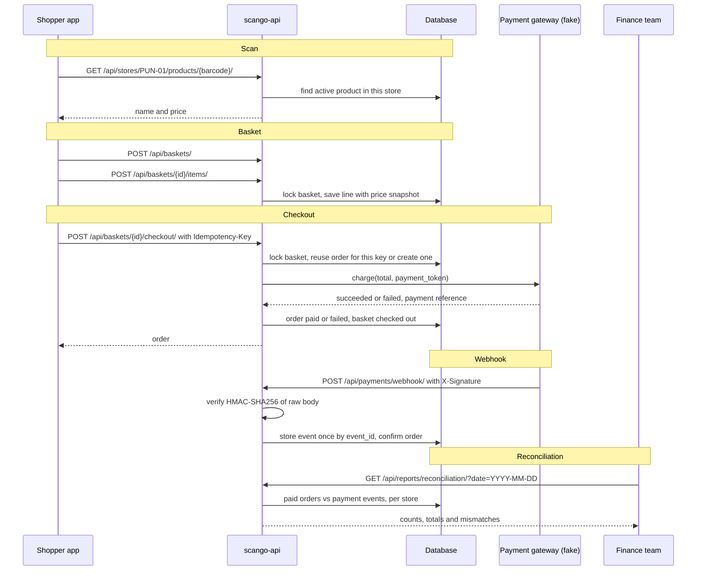

# scango-api

A mini version of a **Scan & Go checkout backend**, built with Django and Django REST Framework.

In a Scan & Go store the shopper scans products with their phone, builds a basket, and pays in
the app without queuing at a till. Behind that app sits a backend that has to get a few things
exactly right: the price of every product in *this* store, a basket that doesn't change under
the shopper's feet, a checkout that never charges twice, and records that finance can reconcile
against the payment provider at the end of the day. This project implements that core:

- **Catalogue:** stores, per-store products, and a CSV import that cleans messy retailer files.
- **Baskets:** scan items into a basket, with prices locked in when scanned.
- **Checkout:** idempotent, row-locked checkout against a (fake) payment gateway.
- **Webhooks:** signed payment callbacks, stored once even when the provider retries.
- **Reconciliation:** a daily report of paid orders versus payment events, per store.

## Request flow



## Project layout

| Path | What it holds |
| --- | --- |
| `config/` | Django settings (read from environment variables) and the root URL list |
| `catalogue/models.py` | `Store`, `Product`, `ImportRun` |
| `catalogue/importer.py` | CSV cleaning, validation and upsert logic |
| `catalogue/management/commands/` | `import_catalogue` and `seed_demo` |
| `checkout/models.py` | `Basket`, `BasketItem`, `Order`, `PaymentEvent` |
| `checkout/services.py` | Basket, checkout and webhook rules (locking, idempotency) |
| `checkout/payments.py` | `PaymentGateway` interface, `FakeGateway`, signature check |
| `checkout/reconciliation.py` | The reconciliation queries, with the equivalent SQL |
| `scripts/send_test_webhook.py` | Signs and sends a webhook to the local server |
| `sample_data/pune_catalogue.csv` | 30 deliberately messy catalogue rows |

## Running it locally (PowerShell)

Requires Python 3.11+.

```powershell
python -m venv .venv
.venv\Scripts\Activate.ps1
pip install -r requirements.txt
python manage.py migrate
python manage.py seed_demo
python manage.py runserver
```

The API is then at http://127.0.0.1:8000/api/ and the admin at http://127.0.0.1:8000/admin/
(create a login with `python manage.py createsuperuser`).

Settings come from environment variables; `.env.example` lists them all. Without any set, the
app uses SQLite and local-only defaults, so the commands above just work. To override one for
the current PowerShell session:

```powershell
$env:PAYMENT_WEBHOOK_SECRET = "my-local-secret"
```

### Seeding and importing

`seed_demo` creates the stores PUN-01 (Pune) and MUM-01 (Mumbai) and imports
`sample_data/pune_catalogue.csv` into PUN-01. It is safe to run more than once.

```text
Store PUN-01: created
Store MUM-01: created
Total: 30  Created: 19  Updated: 0  Unchanged: 0  Failed: 11
Error report: D:\...\scango-api\reports\import_PUN-01_20261031_070735.csv
```

To import any file, optionally as a dry run that validates and reports without writing to the
database:

```powershell
python manage.py import_catalogue PUN-01 sample_data\pune_catalogue.csv --dry-run
python manage.py import_catalogue PUN-01 sample_data\pune_catalogue.csv
```

The error report lists each rejected row with its spreadsheet row number, barcode and reason:

```text
row_number,barcode,reason
10,8900000010097,duplicate barcode in file; replaced by row 20
21,8900000010173,invalid EAN-13 check digit
22,8900000010189,missing price
...
```

## Running with Docker

```powershell
copy .env.example .env      # then edit the values
docker compose up --build
```

This starts PostgreSQL 16 and the API on http://localhost:8000, running migrations first.
The database lives in the `postgres_data` volume, so it survives restarts. In a second terminal:

```powershell
docker compose exec web python manage.py seed_demo
docker compose exec web pytest
```

> **Untested:** Docker was not available on the machine these files were written on, so
> `Dockerfile` and `docker-compose.yml` have not been run. The PostgreSQL settings were only
> checked as far as Django loading the PostgreSQL driver; the test suite has only been run on
> SQLite.

## Running the tests

```powershell
.venv\Scripts\Activate.ps1
pytest
```

84 tests cover product lookup, every kind of messy import row, dry runs and re-imports, price
snapshots, idempotent checkout (one order and one charge per key), webhook signatures and
duplicates, and the reconciliation report. `pytest -v` lists them by name.

## API examples

Every endpoint, first with curl (for bash: Git Bash, macOS or Linux), then with PowerShell's
`Invoke-RestMethod`. In Windows PowerShell `curl` is an alias for `Invoke-WebRequest`, so use the
PowerShell versions there. The examples assume the server is running and `seed_demo` has run.

```bash
API=http://127.0.0.1:8000/api
```

```powershell
$api = "http://127.0.0.1:8000/api"
```

### List stores: `GET /api/stores/`

```bash
curl $API/stores/
```

```powershell
Invoke-RestMethod "$api/stores/"
```

```json
[{"code": "MUM-01", "name": "Mumbai Store", "city": "Mumbai", "currency": "INR"},
 {"code": "PUN-01", "name": "Pune Store", "city": "Pune", "currency": "INR"}]
```

### List or search a store's products: `GET /api/stores/{code}/products/?search=`

Active products only, 20 per page (`?page=2` for the next page). `search` matches name, SKU or
barcode.

```bash
curl "$API/stores/PUN-01/products/?search=butter"
```

```powershell
Invoke-RestMethod "$api/stores/PUN-01/products/?search=butter"
```

```json
{"count": 2, "next": null, "previous": null,
 "results": [{"barcode": "012345678905", "sku": "IMP-001", "name": "Imported Peanut Butter 340g", "price": "649.00"},
             {"barcode": "8900000010011", "sku": "DAI-001", "name": "Salted Butter 500g", "price": "275.00"}]}
```

### Look up a scanned barcode: `GET /api/stores/{code}/products/{barcode}/`

404 if the store doesn't exist, the barcode isn't in that store, or the product is inactive.

```bash
curl $API/stores/PUN-01/products/8900000010011/
```

```powershell
Invoke-RestMethod "$api/stores/PUN-01/products/8900000010011/"
```

```json
{"barcode": "8900000010011", "sku": "DAI-001", "name": "Salted Butter 500g", "price": "275.00"}
```

### Create a basket: `POST /api/baskets/`

```bash
BASKET=$(curl -s -X POST $API/baskets/ -H "Content-Type: application/json" \
  -d '{"store_code": "PUN-01"}' | python -c "import sys, json; print(json.load(sys.stdin)['id'])")
```

```powershell
$basket = Invoke-RestMethod "$api/baskets/" -Method Post -ContentType "application/json" -Body '{"store_code": "PUN-01"}'
$basketId = $basket.id
```

Returns 201 with the empty basket (see the next example for its shape).

### Add an item: `POST /api/baskets/{id}/items/`

Adding a product that is already in the basket increases its quantity. Returns the whole basket.

```bash
curl -X POST $API/baskets/$BASKET/items/ -H "Content-Type: application/json" \
  -d '{"barcode": "8900000010011", "quantity": 2}'
curl -X POST $API/baskets/$BASKET/items/ -H "Content-Type: application/json" \
  -d '{"barcode": "40170725", "quantity": 1}'
```

```powershell
Invoke-RestMethod "$api/baskets/$basketId/items/" -Method Post -ContentType "application/json" -Body '{"barcode": "8900000010011", "quantity": 2}'
Invoke-RestMethod "$api/baskets/$basketId/items/" -Method Post -ContentType "application/json" -Body '{"barcode": "40170725", "quantity": 1}'
```

### Remove a line: `DELETE /api/baskets/{id}/items/{barcode}/`

Returns 204 with no body.

```bash
curl -X DELETE $API/baskets/$BASKET/items/40170725/
```

```powershell
Invoke-RestMethod "$api/baskets/$basketId/items/40170725/" -Method Delete
```

### View a basket: `GET /api/baskets/{id}/`

```bash
curl $API/baskets/$BASKET/
```

```powershell
Invoke-RestMethod "$api/baskets/$basketId/"
```

```json
{"id": "524d8c44-67b9-4987-9e4e-9e9b0d22d58d", "store_code": "PUN-01", "status": "open",
 "items": [{"barcode": "8900000010011", "name": "Salted Butter 500g", "quantity": 2,
            "unit_price": "275.00", "line_total": "550.00"}],
 "subtotal": "550.00", "created_at": "2026-10-31T07:20:05.869463Z"}
```

### Check out: `POST /api/baskets/{id}/checkout/`

Needs an `Idempotency-Key` header: any unique string the app makes up for this checkout attempt
and sends again if it retries. Use `"payment_token": "tok_success"` for a successful payment or
`"tok_fail"` for a declined one.

- First request: 201 and the new order.
- Same key, same basket again: 200 and the *same* order. No second charge.
- Same key, different basket: 409.
- No key, empty basket, or basket already checked out: 400.

```bash
curl -X POST $API/baskets/$BASKET/checkout/ -H "Content-Type: application/json" \
  -H "Idempotency-Key: checkout-$BASKET" -d '{"payment_token": "tok_success"}'
```

```powershell
$order = Invoke-RestMethod "$api/baskets/$basketId/checkout/" -Method Post -ContentType "application/json" -Headers @{ "Idempotency-Key" = "checkout-$basketId" } -Body '{"payment_token": "tok_success"}'
```

```json
{"id": "36e6c685-54a5-417b-ac3c-499a68556767", "basket": "524d8c44-67b9-4987-9e4e-9e9b0d22d58d",
 "store_code": "PUN-01", "total": "550.00", "status": "paid",
 "payment_reference": "fake_b32192b9e22e4826",
 "created_at": "2026-10-31T07:20:06.723904Z", "paid_at": "2026-10-31T07:20:06.726880Z"}
```

### View an order: `GET /api/orders/{id}/`

```bash
ORDER=36e6c685-54a5-417b-ac3c-499a68556767   # the id from the checkout response
curl $API/orders/$ORDER/
```

```powershell
Invoke-RestMethod "$api/orders/$($order.id)/"
```

### Payment webhook: `POST /api/payments/webhook/`

The provider signs the raw body with HMAC-SHA256 using the shared `PAYMENT_WEBHOOK_SECRET` and
sends the hex digest in `X-Signature`. A wrong or missing signature gets 401. A repeated
`event_id` gets 200 with `"duplicate": true` and is not processed again. Supported types are
`payment.succeeded` and `payment.refunded`.

The easiest way is the script, which signs for you:

```powershell
python scripts\send_test_webhook.py $order.id
python scripts\send_test_webhook.py $order.id --event-id evt_1   # run twice to see a duplicate
python scripts\send_test_webhook.py $order.id --type payment.refunded
```

Or by hand:

```bash
BODY='{"event_id": "evt_manual_1", "type": "payment.succeeded", "order_id": "'$ORDER'"}'
SIG=$(printf '%s' "$BODY" | openssl dgst -sha256 -hmac "local-dev-webhook-secret" | sed 's/^.* //')
curl -X POST $API/payments/webhook/ -H "Content-Type: application/json" -H "X-Signature: $SIG" -d "$BODY"
```

```powershell
$body = '{"event_id": "evt_manual_2", "type": "payment.succeeded", "order_id": "' + $order.id + '"}'
$hmac = [System.Security.Cryptography.HMACSHA256]::new([System.Text.Encoding]::UTF8.GetBytes("local-dev-webhook-secret"))
$signature = -join ($hmac.ComputeHash([System.Text.Encoding]::UTF8.GetBytes($body)) | ForEach-Object { $_.ToString("x2") })
Invoke-RestMethod "$api/payments/webhook/" -Method Post -ContentType "application/json" -Headers @{ "X-Signature" = $signature } -Body $body
```

```json
{"event_id": "evt_manual_1", "duplicate": false}
```

### Reconciliation report: `GET /api/reports/reconciliation/?date=YYYY-MM-DD`

```bash
curl "$API/reports/reconciliation/?date=2026-10-31"
```

```powershell
Invoke-RestMethod "$api/reports/reconciliation/?date=2026-10-31" | ConvertTo-Json -Depth 5
```

```json
{"date": "2026-10-31",
 "stores": [{"store_code": "MUM-01", "paid_orders": {"count": 0, "total": "0.00"},
             "payment_events": {"count": 0}, "orders_without_event": [], "events_without_paid_order": []},
            {"store_code": "PUN-01", "paid_orders": {"count": 3, "total": "710.00"},
             "payment_events": {"count": 2},
             "orders_without_event": ["54e3a8a6-0408-4ac7-b292-4ebf525fa4bd"],
             "events_without_paid_order": []}],
 "events_without_order": ["evt_304c8d5b2c2a4844"]}
```

Here one PUN-01 order was paid but its webhook never arrived, and one event named an order id
that doesn't exist, so it can't be placed under a store.

## Design decisions

**Decimal for money.** Floats store most decimal fractions approximately (0.1 + 0.2 is
0.30000000000000004), and those errors add up across baskets and days. Every amount is a
`Decimal` in Python and a `DecimalField(max_digits=10, decimal_places=2)` in the database, and
the API sends amounts as strings (`"275.00"`) so no JSON client turns them back into floats.

**Per-store barcode uniqueness.** A retailer's stores sell the same product (same barcode) at
different prices and with different ranges, so every store has its own catalogue. The rule is a
`UniqueConstraint(store, barcode)` in the database rather than only a check in Python, so it
holds even if two imports run at once. Every lookup is scoped by store code as well as barcode.

**Price snapshots.** When an item goes into a basket, its current price is copied into
`BasketItem.unit_price`. If the catalogue price changes while the shopper is still in the
aisle, their basket, and so their total at checkout, stays at the price they saw when scanning.

**Idempotency keys.** Phones lose signal. If a checkout request times out, the app can't know
whether the payment went through, so it retries. Each checkout carries an `Idempotency-Key`
header; the first request creates the order and stores the key on it (unique in the database),
and a retry with the same key gets the original order back with 200 without calling the
gateway again. Reusing a key for a different basket is a client bug, so it gets 409 rather than
silently returning someone else's order.

**Row locking at checkout.** Checking "does an order exist for this key?" and then creating one
is a race if two identical requests arrive together: both could see "no" and both could charge.
Checkout therefore runs in a transaction that first locks the basket row with
`select_for_update()`. The second request waits until the first commits, then finds the order
and returns it. Adding and removing items take the same lock, so a basket can't change halfway
through its checkout. (SQLite ignores `select_for_update`; it serialises writes anyway.
PostgreSQL takes a real row lock.)

**Webhook signatures and duplicate events.** Anyone can POST to a public URL, so the webhook
only trusts a request whose `X-Signature` is the HMAC-SHA256 of the exact raw body under a
secret shared with the provider. It is checked before parsing, because re-serialised JSON may
not match the signed bytes, and compared with `hmac.compare_digest`, which takes the same time
whether the first or last character differs, so timing reveals nothing. Providers retry
webhooks they think failed, so `PaymentEvent.event_id` is unique: a repeat is acknowledged with
200 (so the provider stops retrying) but not processed twice. Events naming an unknown order are
still stored, with no order, so they appear in reconciliation instead of vanishing.

**Upserts in the import.** A retailer re-sends its full catalogue regularly, so the import is an
upsert keyed on (store, barcode): new barcodes are created, rows whose SKU, name, price or active
flag differ are updated, and identical rows are counted as unchanged. Running the same file twice
changes nothing. Bad rows don't stop the import; they are skipped and listed in the error report
with their spreadsheet row number, so the retailer can fix them. Within one file the last row for
a barcode wins and earlier ones are reported. The whole store catalogue is loaded once and
written with `bulk_create`/`bulk_update`, rather than one query per row.

**Transactions.** Anything that writes several rows together runs inside `transaction.atomic()`:
the import (all products plus the `ImportRun` record), checkout (order, basket status and payment
result), and webhook processing (event plus order update). If anything fails halfway, the
database rolls back to where it was, so there is never a half-imported catalogue or an order
without its basket closed.

**Reconciliation.** The order table is our view of what was paid; webhook events are the
provider's. At the end of each day finance needs to know they agree. For a date, the report
shows per store the count and total of paid orders, the count of `payment.succeeded` events, and
lists any paid order with no event and any event whose order isn't paid. An event matches its
order whatever day it arrived, so a webhook just after midnight still matches. The queries are
plain ORM filters, aggregates and a `NOT EXISTS` subquery, with the equivalent SQL written next
to each in `checkout/reconciliation.py`.

## Open questions and what I'd build next

Decisions the spec left open, made here in the simplest way and worth discussing:

- **Authentication.** There is none: any client can read any basket by id, and the
  reconciliation report is public. Next: device or API-key auth for shopper apps and kiosks, and
  staff-only access to reports.
- **Retrying a failed payment.** A basket has at most one order, and checkout closes the basket
  whatever the payment result, so after a declined payment the shopper must start a new basket.
  A real app would let them retry with another payment method on the same basket.
- **Failed payment status code.** A declined payment still returns 201 (an order was created)
  with `"status": "failed"`. Returning 402 is a reasonable alternative.
- **Refunds.** `payment.refunded` events are stored and linked to their order, but `Order` has no
  "refunded" status, so the order is unchanged. Next: a refunded status and partial refunds.
- **Gateway call inside the lock.** The gateway is called while the basket row is locked, inside
  the transaction. That's what makes double charges impossible here, but a slow real gateway
  would hold the lock (and a database connection) for the whole call, and if the database commit
  failed after a successful charge, the customer would be charged with no order. A production
  design would commit a pending order first, charge with the provider's own idempotency key,
  then record the result, with reconciliation catching any gaps.
- **Same key on two baskets at the same moment.** The two requests lock different baskets, so
  the database's unique constraint on the key is what stops the second one. It surfaces as a
  500 error rather than a clean 409.
- **Re-adding an item keeps the first price.** If the price changes between two scans of the
  same product, the line keeps the price from the first scan.
- **Events carry no amount.** The webhook payload has no amount, so reconciliation compares
  counts and lists mismatches but can't detect an amount mismatch. Next: an amount on each event
  and a totals comparison.
- **Time zones.** Reconciliation days are UTC days. For stores in India, a day should run
  midnight to midnight IST. Next: a time zone on `Store`.
- **Import details.** Only EAN-13 check digits are validated (EAN-8 and UPC-A have check digits
  too); a blank `active` cell means active; files that aren't UTF-8 are rejected; products missing
  from a file are left alone rather than deactivated; a dry run writes nothing to the database but
  does write its error report file.
- **Webhook replay.** The signature covers the body but not a timestamp. Providers usually sign a
  timestamp too, so old captured requests can be rejected.
- **No limits on quantity or basket size.**
- **Production setup.** Docker runs Django's development server; production would use gunicorn,
  `DEBUG=false`, real secrets, and static file serving. Next: CI that runs the tests on
  PostgreSQL for every push.
